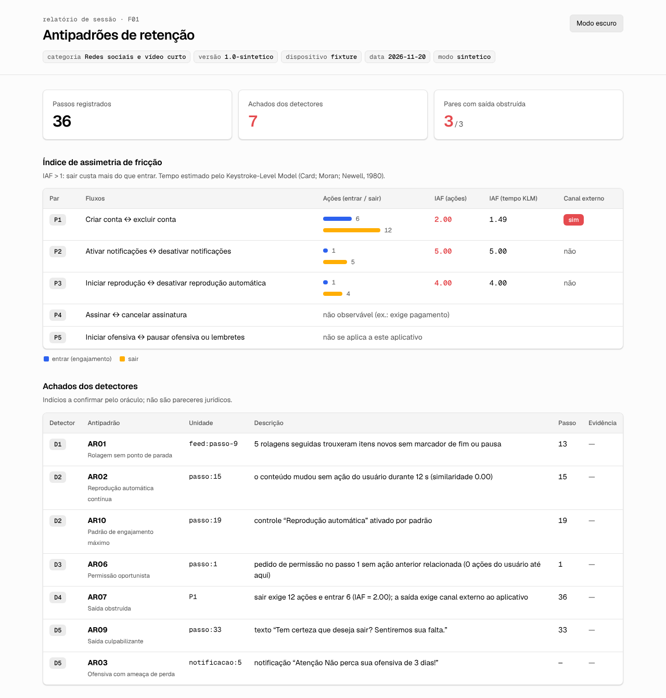

# Antipadrões de retenção em aplicativos móveis — protótipo e piloto (TCC 1)

Repositório do TCC **“Antipadrões de retenção em aplicativos móveis: catálogo, requisitos testáveis e
detecção automatizada”** — Bacharelado em Engenharia de Software, PUCPR.
Autores: Gustavo Gaspar de Campos, Ícaro Ales Nery e João Vítor D’El-Rey Raposo ·
Orientadora: Profa. Sofia Tadeu Tzvika Marshallowitz Apuzzo.

O trabalho trata técnicas usadas para prender o usuário (rolagem infinita, reprodução automática,
ofensivas com ameaça de perda, notificações de reengajamento, permissões oportunistas, saída e
cancelamento obstruídos) como **defeitos de projeto**: com nome e sintoma (catálogo), com requisito
verificável (Gherkin) e com teste automatizado (ferramenta). Este repositório é a entrega de
**protótipo/piloto** da 2ª Avaliação Somativa.

## O que o projeto prevê para o TCC 1 e onde está

| Previsto no projeto | Seção do projeto | Neste repositório | Situação |
|---|---|---|---|
| Protocolo de inspeção sistemática | 3.2.4, Apêndice A | [`protocolo/`](protocolo/) — protocolo, livro de códigos, ficha modelo e ficha de exemplo | ✅ pronto · revisão pós-piloto em [`piloto/mudancas_protocolo.md`](piloto/mudancas_protocolo.md) |
| Piloto em 2 aplicativos, pares de fluxos e IAF | 3.2.4, Quadro 3-4 | [`piloto/`](piloto/) — fichas, sessões, `iaf.csv` | 🟡 estrutura e scripts prontos · coleta em andamento |
| Calibração da codificação (kappa ≥ 0,61) | 3.2.4 | `python -m antipadroes kappa …` + [`piloto/codificacao/`](piloto/codificacao/) | 🟡 script pronto · rodada 1 em andamento |
| Catálogo de antipadrões (v0) | Etapa 1, Quadros 3-5 e 3-6 | [`catalogo/`](catalogo/) — 10 entradas no formato de antipadrões | ✅ pronto |
| Requisitos de aceitação em Gherkin | Quadro 3-7, Apêndice C | [`requisitos/`](requisitos/) — 10 funcionalidades, 15 cenários executáveis | ✅ pronto |
| Arquitetura da ferramenta | Figura 3-2 | [`docs/arquitetura.md`](docs/arquitetura.md) e ADRs | ✅ pronto |
| Esboço do coletor e testes | Quadro 5-2 (S18) | [`ferramenta/`](ferramenta/) — coletor Appium, detectores D1–D5, verificador, relatório; [`tests/`](tests/) e CI | ✅ pronto (D1 e D2 experimentais) |

## Ver funcionando em 1 minuto (sem emulador)

```bash
pip install -e ".[dev]"
pytest                                                       # testes unitários e de integração
python -m antipadroes verificar tests/fixtures/sessoes/F01   # app sintético que VIOLA: requisitos reprovados
python -m antipadroes verificar tests/fixtures/sessoes/F02   # app sintético CONFORME: requisitos aprovados
python -m antipadroes analisar  tests/fixtures/sessoes/F01   # gera relatorio.html com IAF, achados e vereditos
```

Saída esperada (trecho) para F01:
```
reprovado    Simetria entre entrar e sair :: Excluir a conta não custa mais do que criá-la  (IAF = 2.00 (sair: 12 ações; entrar: 6 ações) excede 1.0)
reprovado    Controle da reprodução automática :: Desativar a reprodução automática a partir do player  (foram necessárias 4 ações (limite: 3))
indecidivel  Cancelamento simétrico à assinatura :: Cancelar não custa mais do que assinar  (par P4 não observável (ex.: exige pagamento))
{'aprovado': 0, 'reprovado': 10, 'indecidivel': 5} proporção decidível: 0.667
```

Relatório gerado para F01 (abre no navegador, com botão para modo claro/escuro):



## Como funciona

```
roteiro YAML ──► coletor (Appium/UiAutomator2) ─┐
                                                 ├─► sessão (ações + telas + XML) ─► IAF/KLM
ficha CSV da inspeção manual ───────────────────┘          │
                                                            ├─► detectores D1–D5 ──► achados
                                                            ├─► requisitos Gherkin ──► aprovado / reprovado / indecidível
                                                            └─► relatório HTML/JSON
```

| Detector | Antipadrões | Evidência usada | Estado |
|---|---|---|---|
| D1 Rolagem sem ponto de parada | AR01 | itens novos a cada rolagem, ausência de marcador de fim | experimental |
| D2 Reprodução automática | AR02, AR10 | troca de conteúdo sem ação; estado padrão do controle | experimental |
| D3 Permissão oportunista | AR06 | diálogo de permissão sem ação relacionada; área dos botões | pronto |
| D4 Saída obstruída | AR07, AR08 | IAF dos pares P1/P4; saída por canal externo | pronto |
| D5 Ameaça de perda e culpabilização | AR03, AR09 | padrões textuais em telas e notificações | pronto |

**Índice de assimetria de fricção (IAF)** = ações para sair ÷ ações para entrar (e o mesmo com o
tempo estimado pelo *Keystroke-Level Model*). IAF > 1: sair custa mais do que entrar.

## Comandos

| Comando | Para quê |
|---|---|
| `python -m antipadroes ficha <ficha.csv> <sessao>` | converte a ficha da inspeção manual em sessão |
| `python -m antipadroes coletar <sessao> <roteiro.yaml>…` | executa roteiros no emulador/dispositivo |
| `python -m antipadroes iaf <sessoes>… --csv piloto/iaf.csv` | IAF por par |
| `python -m antipadroes detectar <sessao>` | achados dos detectores |
| `python -m antipadroes verificar <sessao>` | executa a biblioteca Gherkin |
| `python -m antipadroes analisar <sessoes>…` | tudo acima + `relatorio.html` |
| `python -m antipadroes kappa <codificacao.csv>` | kappa de Fleiss (3 codificadores) ou de Cohen (2) |
| `python -m antipadroes avaliar <oraculo.csv> <sessoes>…` | precisão, revocação e F1 dos detectores (TCC 2) |
| `python -m antipadroes piloto --codificadores <nomes>…` | piloto inteiro: fichas → sessões → IAF → planilhas de codificação → kappa → `piloto/resultados.md` |
| `python -m antipadroes notificacoes <sessao> --pacote <pkg>` | registra notificações ativas (experimental) |

Montagem do ambiente com emulador e Appium: [`docs/ambiente.md`](docs/ambiente.md).
Roteiro da demonstração na apresentação: [`docs/demo_apresentacao.md`](docs/demo_apresentacao.md).

## Estrutura

```
catalogo/        catálogo de antipadrões v0 (AR01–AR10) e gerador
requisitos/      biblioteca Gherkin (pt) + steps do behave
ferramenta/      pacote Python `antipadroes` e roteiros de exemplo
protocolo/       protocolo de inspeção, livro de códigos, fichas modelo e exemplo
piloto/          fichas, sessões, codificação e resultados do piloto (2 apps)
tests/           testes (pytest) e sessões sintéticas F01/F02
docs/            arquitetura, ADRs, ambiente e demonstração
```

## Ética e anonimização
Apenas contas de teste de adultos, sem pagamentos e sem interação com outros usuários. Os
aplicativos aparecem só por código (A01, A02…); roteiros com o pacote real ficam em
`ferramenta/roteiros/local/` (fora do versionamento); conteúdo de terceiros nas capturas é ocultado.
Os achados são indícios técnicos a confirmar pelo oráculo, não pareceres jurídicos.

## Limitações do protótipo
- D1 e D2 são experimentais e ainda não foram calibrados em apps reais.
- Apps que bloqueiam captura ou automação são inspecionados manualmente (risco R02 do projeto).
- A observação de 14 dias de notificações é parcial no TCC 1 e completa no TCC 2.
- A avaliação por precisão, revocação e F1 e o estudo com desenvolvedores são do TCC 2 (Capítulo 4).

Licença: MIT.
