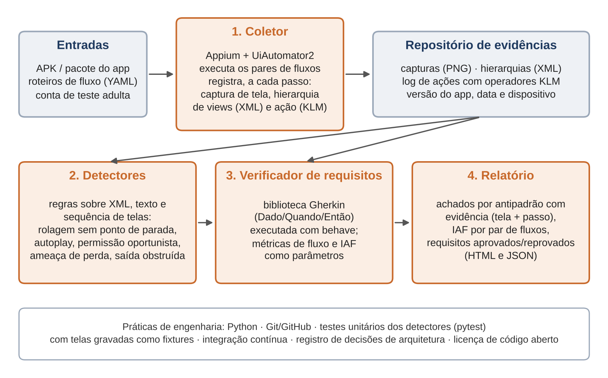

# Arquitetura da ferramenta

| Módulo (Figura 3-2) | Código | Entrada → saída |
|---|---|---|
| 1. Coletor | `ferramenta/antipadroes/coletor.py` | roteiros YAML → sessão (`acoes.jsonl`, `telas/*.png|xml`) |
| Entrada manual | `ficha.py` | ficha CSV da inspeção → sessão no mesmo formato |
| Repositório de evidências | `modelo.py` | formato único de sessão, usado por todos os módulos |
| Métricas de fluxo | `klm.py`, `iaf.py` | ações → tempo KLM e IAF por par |
| 2. Detectores | `detectores/d1…d5` | sessão → achados (`achados.json`) |
| 3. Verificador de requisitos | `verificador.py`, `requisitos/` | sessão → vereditos dos cenários Gherkin (`requisitos.jsonl`) |
| 4. Relatório | `relatorio.py` | sessão + achados + vereditos → `relatorio.html` e `relatorio.json` |
| Avaliação | `avaliacao.py`, `concordancia.py` | oráculo → precisão, revocação, F1; codificações → kappa |

## Decisões registradas
- [ADR 0001 – Detectores baseados em regras](adr/0001-detectores-por-regras.md)
- [ADR 0002 – Formato único de sessão para inspeção manual e automatizada](adr/0002-formato-unico-de-sessao.md)
- [ADR 0003 – Requisitos em Gherkin executados com behave](adr/0003-gherkin-com-behave.md)

## Unidade de análise
Achados e oráculo usam a mesma chave `(app, unidade, antipadrão)`: `P1`…`P5` para pares,
`tela:<arquivo>` (ou `passo:<n>`) para telas, `feed:passo-<n>` para rolagens e `notificacao:<n>`.
